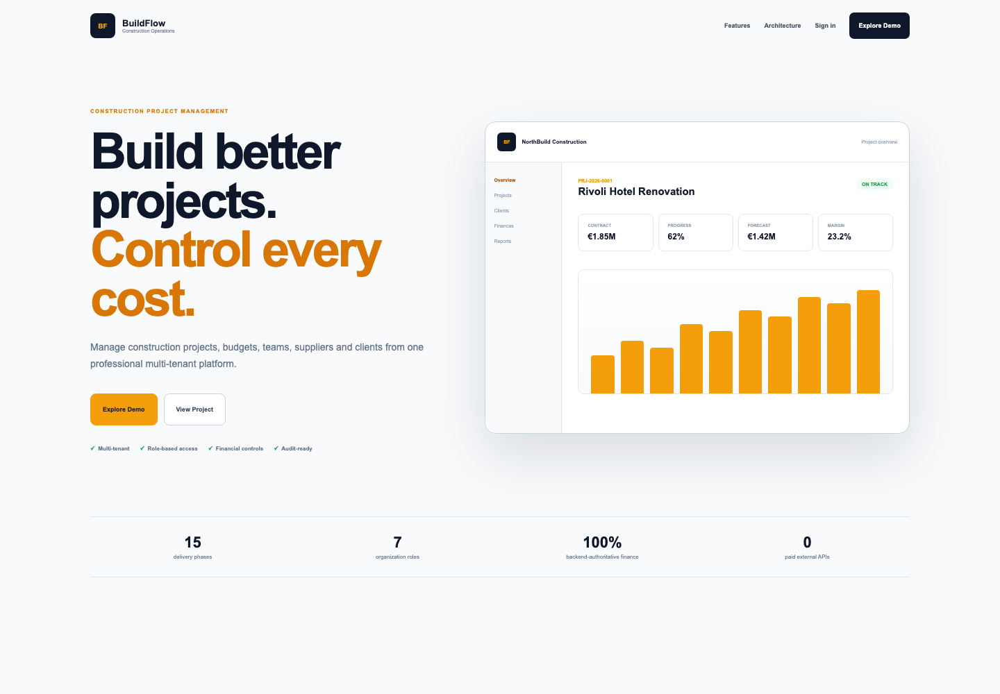
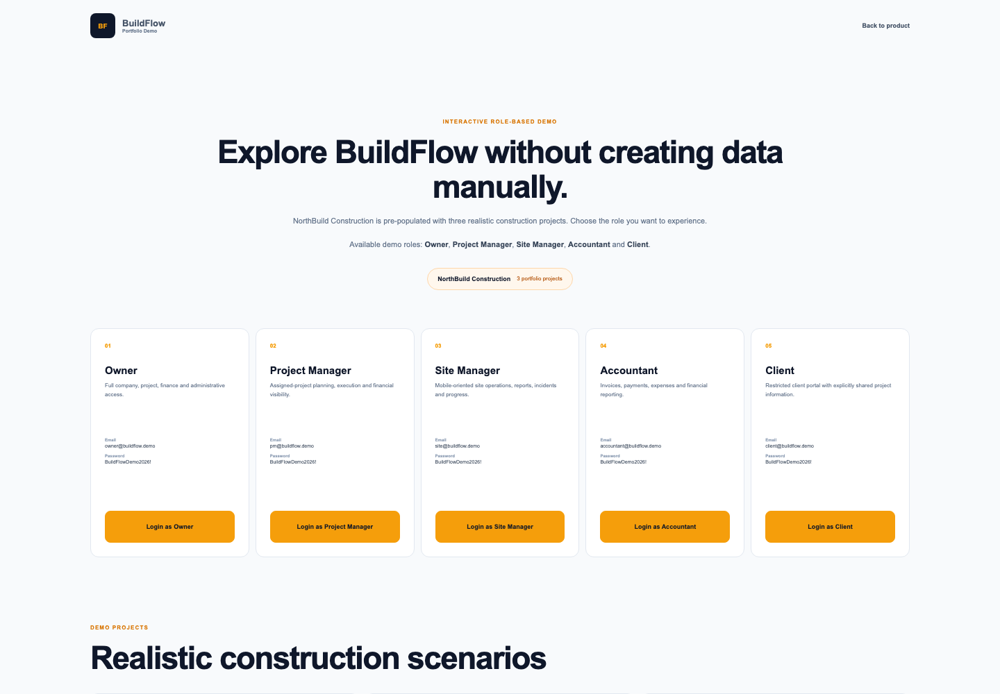
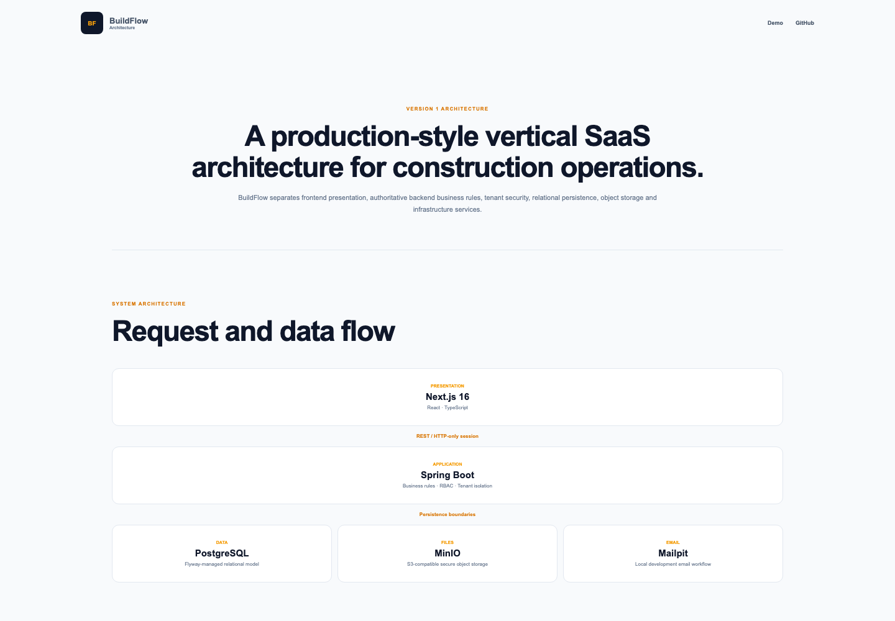

# BuildFlow

Construction project management and cost control platform: plan projects, track budgets against actual and committed cost, run procurement and site operations, invoice clients, and keep everyone informed through a client portal.

## Features

- **Multi-tenant organizations** with roles, member management and email invitations
- **Projects, clients and suppliers** with directories and creation workflows
- **Tasks and milestones** with progress tracking
- **Budgets and expenses** with actual, committed and forecast cost
- **Procurement**: purchase orders and goods receipts
- **Commercial**: quotes, invoices and payments
- **Change orders** with client approval through the portal
- **Site operations**: daily reports, incidents and progress updates
- **Documents and photos** in S3-compatible object storage (MinIO)
- **Notifications, activity feed and audit log**
- **PDF and CSV reports**
- **Role-based demo mode** with a seeded showcase dataset

## Tech stack

| Layer | Technology |
| --- | --- |
| Backend | Java, Spring Boot (Web, Security, Data JPA, Validation, Actuator, Mail), Flyway, PDFBox |
| Database | PostgreSQL 17 |
| Storage | MinIO |
| Frontend | Next.js 16, React 19, TypeScript, CSS Modules |
| Testing | JUnit with Testcontainers, Vitest with Testing Library |
| Infrastructure | Docker Compose, Caddy (production) |

Security: opaque session cookies, CSRF protection, login rate limiting, request body limits, origin and tenant header validation, and security headers.

## Getting started

Requires Docker.

    cp .env.example .env
    docker compose up --build

- Frontend: http://localhost:3000
- API: http://localhost:8080
- Mailpit (dev email): http://localhost:8025

Open `/demo` to sign in as one of the seeded demo roles.

### Frontend only

    cd frontend
    pnpm install
    pnpm dev

The API base URL defaults to `http://localhost:8080/api/v1` and can be changed with `NEXT_PUBLIC_API_BASE_URL`.

## Tests

    cd backend && mvn test            # needs Docker for Testcontainers
    cd frontend && pnpm lint && pnpm typecheck && pnpm test

## Project layout

    backend/     Spring Boot API, Flyway migrations, tests
    frontend/    Next.js application
    deploy/      Production Caddyfile and environment example
    portfolio/   Screenshots used in this README

## Deployment

See `docker-compose.production.yml`, `deploy/Caddyfile` and `deploy/.env.production.example`.
