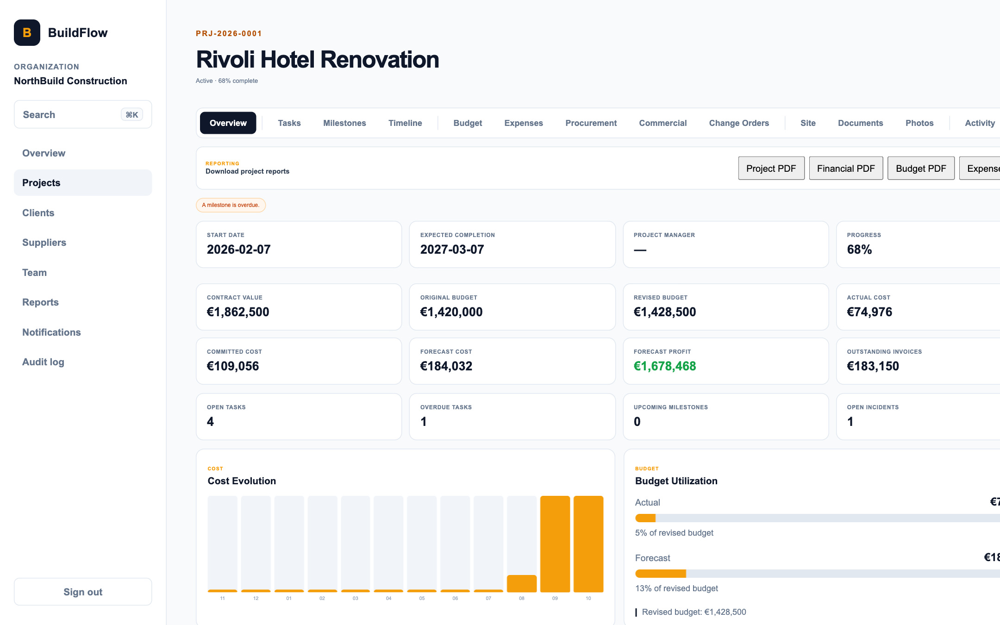
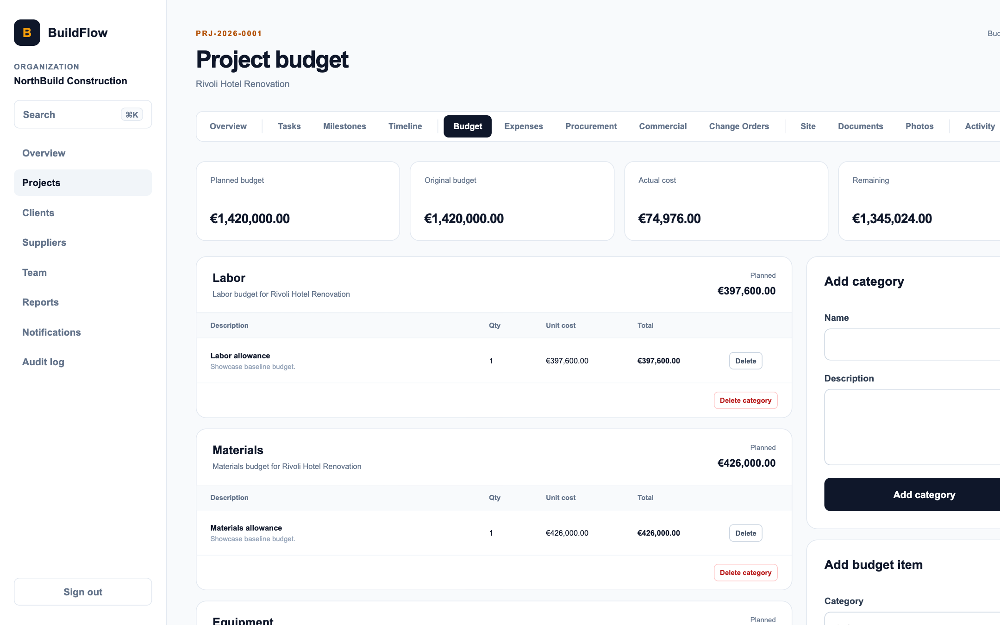
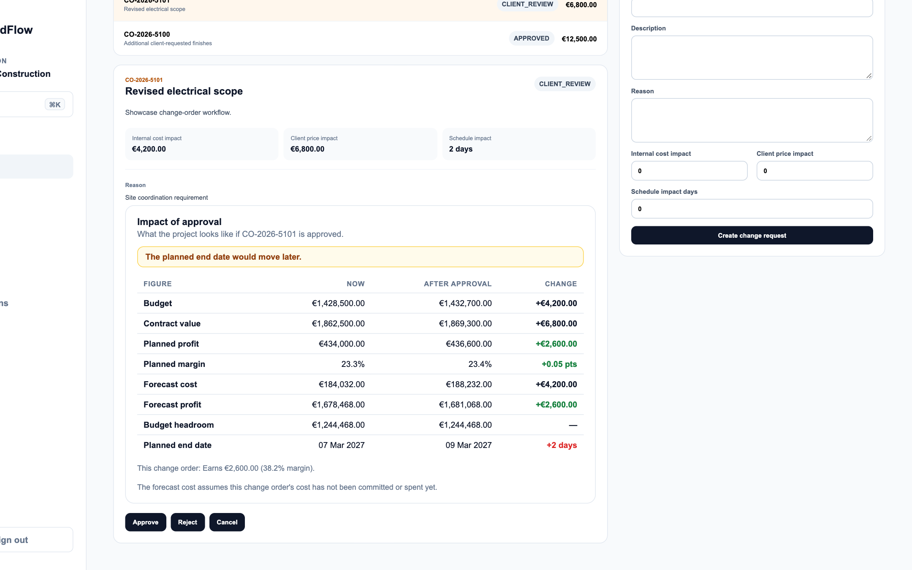
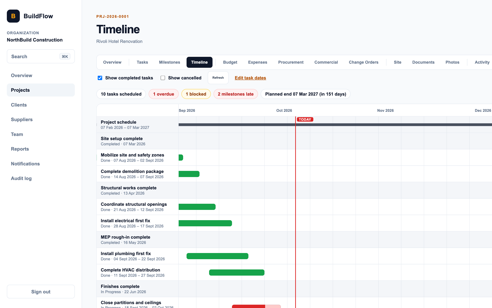
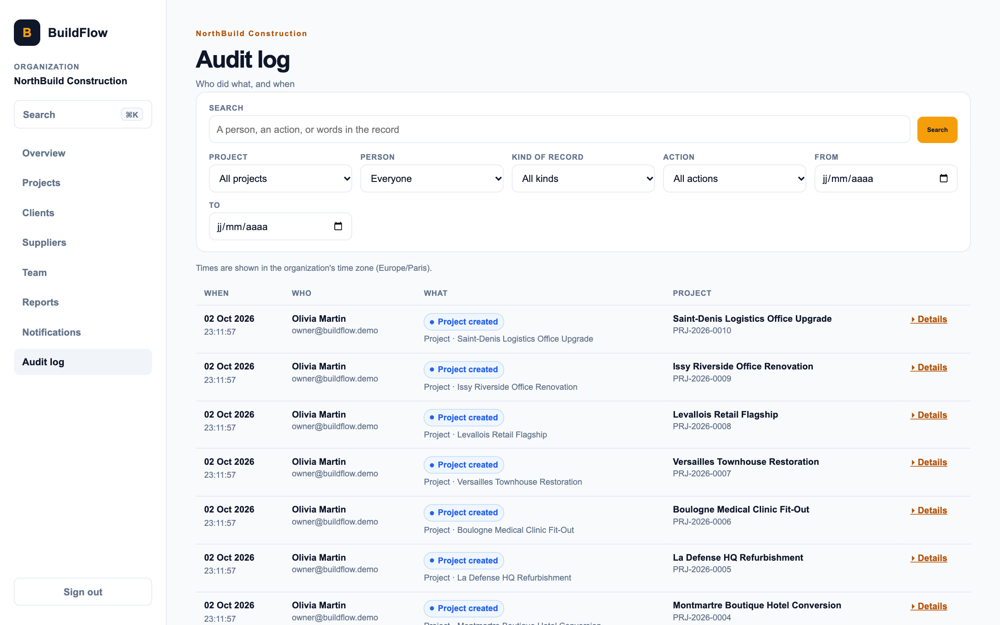
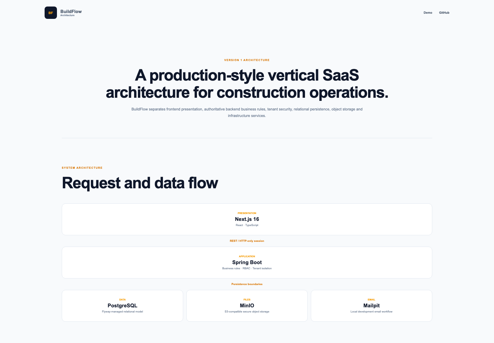

# BuildFlow: see what a change order costs before you approve it

BuildFlow is a project management app for construction companies. Budgets, schedules, site reports and client approvals live in one place, with a separate view for each of five roles.

| | |
| --- | --- |
| Source | https://github.com/MahmoudMans/buildflow |
| Live demo | [live demo URL] |
| Built by | Mahmoud Mansouri, solo project, backend to frontend |
| Time | [how long it took] |
| Status | Working demo with three sample projects and five roles |
| Stack | Java and Spring Boot, PostgreSQL, MinIO, Next.js, React, TypeScript |

## The problem

A construction company runs several jobs at once. The budget is in one spreadsheet, the site photos are in someone's camera roll, and the client's yes or no is buried in an email thread.

The costly moments are the changes. A client asks for a different floor finish, a supplier's price moves, a wall hides a pipe nobody drew. Someone has to say yes or no, and they usually do it without seeing what it does to the budget.

I built BuildFlow around that moment. Everything else in the app (budgets, schedules, site reports) is there so the numbers behind a change order are current when someone has to decide.

## What it does

One organization, five ways of working in it. The demo signs you in as any of them.

| Role | What they work on |
| --- | --- |
| Owner | A company-wide view: what needs attention today, receivables and cash flow, the team and the audit log. |
| Project manager | Runs a project day to day: tasks, milestones, timeline, budget, procurement and change orders. |
| Site manager | Works from a phone: daily site reports with photos, incidents and progress updates. |
| Accountant | Quotes, invoices, payments and expenses, with receivables aging. |
| Client | A portal limited to their own projects: progress, documents, and the change orders waiting for their approval. |

## Where the engineering is

### A change order shows its effect before anyone approves it

Open a pending change order and the impact panel lists the project's figures now, after approval, and the difference. It warns about problems, summarises what the change order earns on its own, and counts the other pending change orders so you can see their combined effect.

The API computes the preview, so the browser never guesses at money. The panel also states its one assumption in plain words: the forecast treats the change order's cost as not yet committed or spent.

### A site report you can finish with one hand

A site manager standing in a half-finished room has one free hand and an unreliable signal. The quick report is four short steps: the basics, the work done, photos, and a review before sending.

It saves a draft on the phone as you type, shrinks photos in the browser before uploading them, and says so when the phone goes offline. Nothing is sent until you choose Send report.

### Finding things quickly in a big app

A project piles up tasks, invoices, reports and people. Command-K opens a search across the app, the dashboard lists what needs attention first, the timeline shows a project's schedule on one chart, and the audit log records who changed what.

### Separate organizations, and a safer default

Each company's data is kept apart: requests name an organization and the server checks that the signed-in user belongs to it. Sessions use opaque cookies rather than tokens kept in browser storage, state-changing requests are protected against CSRF, logins are rate limited, request bodies have size limits, and responses carry the standard security headers.

Integration tests run these rules against a real database, so a change that weakens one fails the test run.

## How it's built

| Layer | Technology |
| --- | --- |
| Backend | Java and Spring Boot (Web, Security, Data JPA, Validation, Actuator, Mail), Flyway, PDFBox |
| Database | PostgreSQL 17 |
| Storage | MinIO, for documents and photos |
| Frontend | Next.js 16, React 19, TypeScript, CSS Modules |
| Testing | JUnit with Testcontainers, Vitest with Testing Library |
| Infrastructure | Docker Compose, with Caddy in front in production |

The schema grows through 13 Flyway migrations, so every environment reaches the same state the same way. Docker Compose runs the whole stack locally, and a production Compose file adds Caddy as the entry point.

## Testing

More than 100 backend tests run against a real PostgreSQL started by Testcontainers, not a mock. The frontend has Vitest and Testing Library tests for its helpers, components and pages.

One seed-data test failed now and then because two steps raced each other. I made the order explicit and ran it repeatedly until it stayed green.

## What I would build next

- Finish a site report with no signal at all, and sync it when the phone reconnects.
- Add a signature step to the client's approval of a change order.
- Run an accessibility pass with a screen reader over the main flows.

## What I learned

[Write this part yourself, in your own words. Two or three sentences is plenty. Good questions to answer: What was harder than you expected? What would you do differently if you started again? Which decision are you most happy with, and why?]
